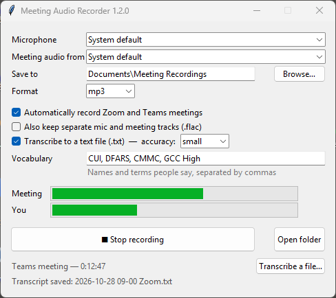

# Meeting Audio Recorder

Record **audio only** from your Zoom and Microsoft Teams meetings on Windows: what the other people say *and* what you say into your microphone. Both are mixed into one MP3 per meeting, with an optional **text transcript** saved next to it.

- **Auto-record:** starts when a Zoom or Teams meeting starts, saves when it ends.
- **Automatic transcripts:** a `.txt` file per meeting, with each line marked **You** or **Others**. It's made on your PC with [Whisper](https://github.com/openai/whisper), so no audio is uploaded.
- **Works with any USB mic or headset.** Pick it from a list.
- **No meeting bots, plugins or accounts.** Everything stays on your PC.
- **Small files:** about 1 MB per minute as MP3. WAV and FLAC are also available.
- Free and open source (MIT).



## Download

Get `MeetingAudioRecorder.exe` (about 100 MB) from the [latest release](../../releases/latest) and run it. You don't need to install anything. It takes several seconds to open while it unpacks.

> Windows may show a "Windows protected your PC" warning because the app isn't code-signed. Click **More info → Run anyway**. If you'd rather not, you can [run it from source](#run-from-source) instead.

## How to use it

1. Open **Meeting Audio Recorder**.
2. Choose your **Microphone** (your USB mic) and the **Meeting audio from** device (the speakers or headset you hear the meeting through). Leave either on *System default* to follow Windows.
3. Leave **Automatically record Zoom and Teams meetings** ticked and keep the window open (minimizing it is fine).
4. Join a meeting. The status line switches to *"Zoom meeting — 0:00:12"*, and the level bars move for **Meeting** and **You**.
5. When you leave the meeting, the recording is saved to `Documents\Meeting Recordings` as e.g. `2026-10-28 14-30 Teams.mp3`. A few minutes later, `2026-10-28 14-30 Teams.txt` appears next to it.

You can also press **Start recording** / **Stop recording** at any time to record by hand, or use **Transcribe a file…** to make a transcript of any audio file you already have.

### Transcripts

```
2026-10-28 14-30 Teams

[00:00:00] Others: Good morning everyone. Let's start with the quarterly budget review.

[00:00:05] You: Thanks. I finished the sales report yesterday and sent it to the team.

[00:00:11] Others: Great work. Can you share the numbers for October before Friday?
```

- **You / Others** labels come from the two separate recordings: your mic and the meeting audio. Individual people in the meeting aren't told apart; they all show as *Others*.
- Transcription runs in the background after each meeting, and you can record the next meeting while it works. It runs on your processor. With the default **small** model, a 45-minute meeting took about 4 minutes on an 8-core desktop.
- **Accuracy** picks the speech model: `tiny` (fastest), `base`, `small` (default) or `medium` (most accurate, slowest). Each model is downloaded once, the first time you use it (75 MB to 1.5 GB). After that it works offline.
- **Vocabulary:** list the acronyms, product names and people's names that come up in your meetings, separated by commas (e.g. `CUI, DFARS, CMMC, GCC High`). Whisper then expects those words and spells them the way you wrote them.
- A new paragraph, with its own timestamp, starts at every pause and at least once a minute, so long stretches of other people talking stay readable.
- The language is detected automatically. Whisper handles about 100 languages.
- Untick **Transcribe to a text file** if you only want the audio.

**Tip:** to check that everything is set up before a real meeting, use Zoom's test meeting at <https://zoom.us/test> or Teams' **Settings → Devices → Make a test call**.

## How it works

| Part | How |
|---|---|
| Other people's voices | Windows **WASAPI loopback**: a copy of the audio going to your speakers/headset. Works no matter which meeting app plays it. |
| Your voice | Recorded straight from your chosen microphone. |
| Mixing | Both tracks are saved while recording, then lined up, resampled if needed and mixed into one file when you stop. |
| Transcription | [faster-whisper](https://github.com/SYSTRAN/faster-whisper) transcribes the mic track and the meeting track separately, then merges them by time. If you use speakers instead of a headset, lines your mic picked up from the speakers are recognized and dropped. |
| Meeting detection | Windows logs which app is using the microphone (the same info behind the mic icon in the taskbar). Zoom and Teams hold the mic for the whole meeting, even while you are muted, so "Zoom/Teams is using the mic" = "you're in a meeting". The recording is saved 15 seconds after they let go of it. |

### Things to know

- **The meeting track is everything you hear.** Notification sounds, music or videos playing during the meeting get recorded too, so mute them.
- **Pick your headset if you switch devices mid-call.** The recorder captures the device that was chosen (or the Windows default) when recording started.
- **Browser meetings** (Teams or Zoom in Chrome/Edge) aren't detected automatically. Use the **Start recording** button for those.
- Windows 10 or 11 only.

## Please get consent

Recording laws differ by country and state. Many places require **everyone** in the call to agree to being recorded. Tell participants you're recording, and follow your workplace's rules.

## Run from source

Requires Python 3.10+ on Windows.

```bash
git clone https://github.com/zimba7768/meeting-audio-recorder.git
cd meeting-audio-recorder
pip install -r requirements.txt
python -m meeting_recorder
```

### Command line

```bash
python -m meeting_recorder --list-devices           # show mics and speakers
python -m meeting_recorder --cli                    # record now, Ctrl+C to stop
python -m meeting_recorder --auto --mic 30          # wait for meetings, use mic #30
python -m meeting_recorder --cli --format flac --keep-tracks --out D:\Recordings
python -m meeting_recorder --auto --transcribe --vocabulary "CUI, DFARS, CMMC"   # record and transcribe every meeting
python -m meeting_recorder --transcribe-file "old meeting.mp3"   # transcribe an existing file
```

### Build the .exe yourself

```powershell
.\build.ps1        # creates dist\MeetingAudioRecorder.exe
```

Pushing a tag like `v1.0.1` makes GitHub Actions build the exe and attach it to a release.

## Contributing

Issues and pull requests are welcome. Ideas that would make it better:

- Record only the meeting app's audio (Windows process loopback), so other sounds are left out
- Tray icon and start-with-Windows option
- Telling individual meeting participants apart in transcripts (speaker diarization)
- Meeting summaries
- Detection of meetings in the browser

## License

[MIT](LICENSE)
